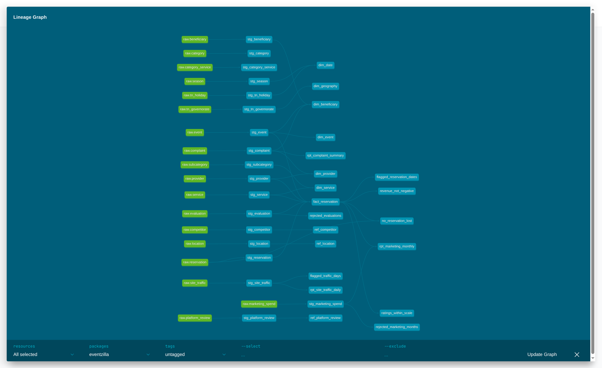
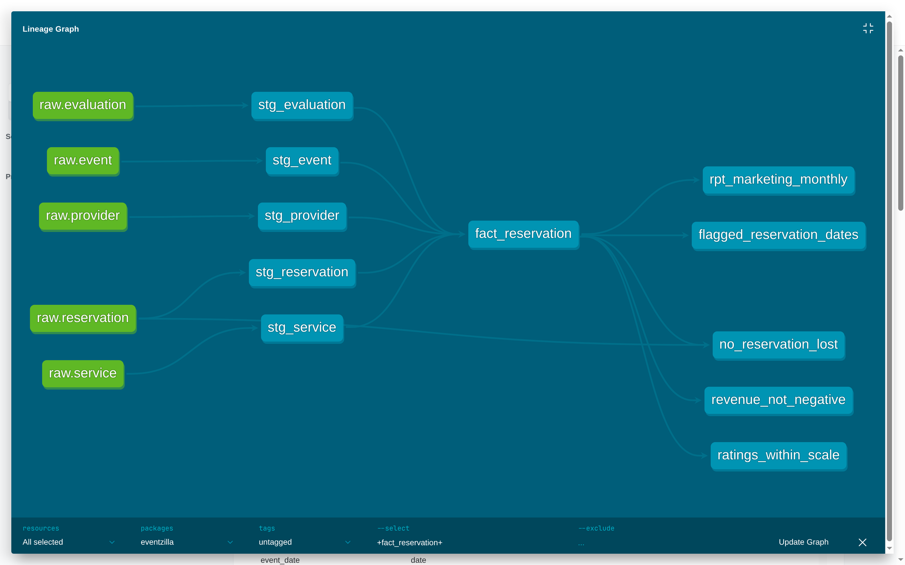
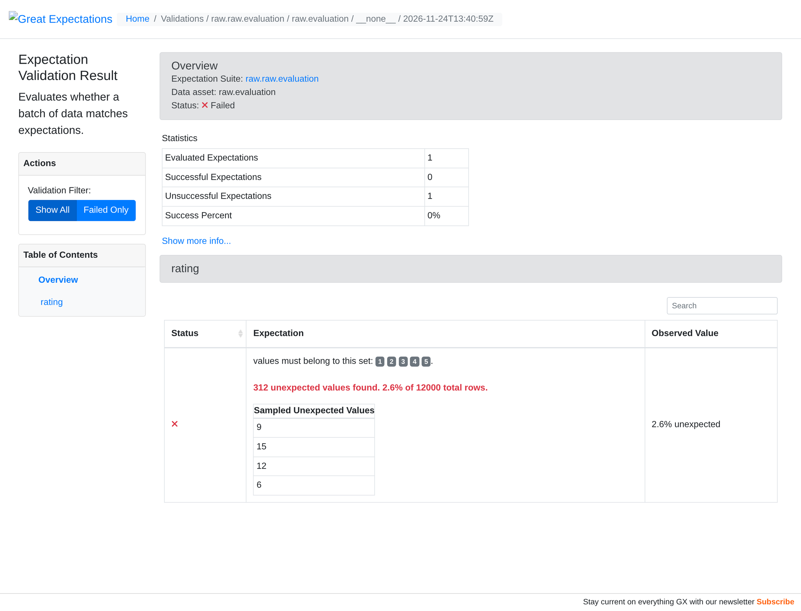

# Data model, lineage and tests

The warehouse is built by dbt (`transformation/`) on top of what Airbyte loads into `raw`. This page describes
the model as it is, how it is tested, where its extra data comes from, and what it does not do yet.

## The star

One fact table at one grain, surrounded by its dimensions.

| | Table | Grain / content | Rows |
|---|---|---|---|
| **Fact** | `marts.fact_reservation` | one row per reservation (every reservation of the source is kept) | 18,000 |
| Dimension | `marts.dim_date` | one row per day 2022-2025: calendar, season, Tunisian holidays, Ramadan. Role-played twice by the fact: `reservation_date` and `event_date` | 1,461 |
| Dimension | `marts.dim_event` | the event booked: type, date, the customer's budget | 12,000 |
| Dimension | `marts.dim_service` | the service booked: title, category, list price | 2,500 |
| Dimension | `marts.dim_provider` | who delivers it: name, service type, city, complaint counts | 800 |
| Dimension | `marts.dim_beneficiary` | the customer: e-mail domain, number of events, returning or not, complaints (no personal data) | 5,000 |
| Dimension | `marts.dim_geography` | Tunisia's 24 governorates: region, population 2024, area, density (scraped, see below) | 24 |

Each measure of the fact answers a business objective of [GIMSI.md](GIMSI.md); dbt carries the mapping in
`meta.objective` so it appears in the generated documentation.

| Measure | Definition | Objective |
|---|---|---|
| `revenue` | final price of confirmed reservations, 0 otherwise | BO1 revenue and profitability |
| `final_price`, `list_price` | price agreed with the customer; catalogue price of the service | BO1 |
| `is_confirmed`, `is_cancelled`, `status` | where the reservation ended up | BO2 reservations and conversion |
| `lead_time_days` | days between booking and the event (kept, flagged, never charted: see quality) | BO2 |
| `rating_avg`, `evaluations` | mean of the valid 1-5 evaluations, and their number | BO3 satisfaction and retention |

Data at other grains is kept out of the fact on purpose: putting monthly marketing, daily website traffic or
undated complaints on reservation rows is what made the first version of this project keep 428 reservations
out of 18,000. They live beside the star:

| Schema | Tables | Why not in the star |
|---|---|---|
| `reporting` | `rpt_marketing_monthly`, `rpt_site_traffic_daily`, `rpt_complaint_summary` | monthly, daily and undated grains |
| `reference` | `ref_competitor`, `ref_platform_review`, `ref_location` | market data with no key to a reservation |
| `quality` | `rejected_evaluations`, `rejected_marketing_months`, `flagged_reservation_dates`, `flagged_traffic_days` | rows the quality rules quarantined or flagged |
| `staging` | 18 `stg_*` tables | typed and cleaned copies of `raw`; personal data stops here |

## Lineage

`raw` (Airbyte) → `staging` → `marts` (the star) → `reporting`, `quality`; `reference` comes straight from
staging. The fact's own lineage:

Regenerate it with `mise run docs` (dbt docs on http://localhost:8081).

## Tests

`dbt build` runs 35 models and 43 tests; every run in Airflow must pass them before the quality checkpoints.

| Kind | Count | What it guarantees |
|---|---|---|
| `unique` | 9 | one row per key in every dimension, the fact and the reporting series |
| `not_null` | 17 | keys and dates are always present |
| `relationships` | 11 | every foreign key points to an existing dimension row (table below) |
| `accepted_values` | 3 | reservation status, complaint status and event type stay within their known values |
| singular | 3 | `no_reservation_lost` (source rows = fact rows), `revenue_not_negative`, `ratings_within_scale` |

**Relationship tests** (referential integrity of the star):

| From | Column | To | Field |
|---|---|---|---|
| `fact_reservation` | `event_id` | `dim_event` | `event_id` |
| `fact_reservation` | `service_id` | `dim_service` | `service_id` |
| `fact_reservation` | `provider_id` | `dim_provider` | `provider_id` |
| `fact_reservation` | `beneficiary_id` | `dim_beneficiary` | `beneficiary_id` |
| `fact_reservation` | `governorate_id` | `dim_geography` | `governorate_id` |
| `fact_reservation` | `reservation_date` | `dim_date` | `date_day` |
| `fact_reservation` | `event_date` | `dim_date` | `date_day` |
| `dim_event` | `beneficiary_id` | `dim_beneficiary` | `beneficiary_id` |
| `dim_service` | `provider_id` | `dim_provider` | `provider_id` |
| `dim_provider` | `governorate_id` | `dim_geography` | `governorate_id` |
| `rpt_complaint_summary` | `provider_id` | `dim_provider` | `provider_id` |

After dbt, Great Expectations runs two checkpoints (`quality/validate.py`): `raw` reports what the sources
deliver, including their known defects, and never blocks; `star_schema` is the gate (15 expectations, among them
row completeness against the source and a column whitelist that keeps personal data out of the marts).

## Quality rules

| Rule | Rows | What happens |
|---|---|---|
| Evaluation rating outside 1-5 (6, 9, 12, 15 at the source) | 312 of 12,000 | quarantined, left out of every average |
| Marketing month that is not a calendar month (`2024-24` …) | 12 of 36 | quarantined |
| Reservation dated after its own event | 8,967 of 18,000 | kept (its revenue is real), flagged; no lead-time indicator anywhere |
| Website day with more reservations than visitors | 6 of 365 | kept, flagged, conversion left empty |

## Enrichment scraped with Firecrawl

The source workbook says nothing about where services are delivered or about the calendar people live by. Two
public datasets fill that gap; `ingestion/scrape_enrichment.py` fetches them with [Firecrawl](https://www.firecrawl.dev)
(the API key stays in `.env`) and lands them next to the workbook, so they follow the same path: S3 → Airbyte →
dbt → tests.

| Entity | Source | Joined to | Verification |
|---|---|---|---|
| `tn_governorate` (24 rows) | Wikipedia, *Governorates of Tunisia* (CC BY-SA 4.0): population 2024, area, region | `dim_geography`, via each provider's city | the providers' 24 cities are exactly the 24 governorates (two differ only by accents) |
| `tn_holiday` (60 rows) | Wikipedia, *Public holidays in Tunisia* (national, 8 a year) and the articles on Ramadan, Eid al-Fitr, Eid al-Adha, the Islamic New Year and Mawlid | `dim_date`: `holiday_name`, `is_holiday`, `is_ramadan` | Islamic dates are computed with the Umm al-Qura calendar and compared with every date Wikipedia lists: 7 of 8 the same day, 1 a day apart (moon sighting); the other 12 are computed only, and each row says which |

Every row carries its source URL and scrape date. The scrape runs at most once a month (`--max-age-days 30`):
the data barely changes, and each run costs seven Firecrawl credits.

## Limits of the model, and what would fix them

A strict review of this model would make these points, fairly:

1. **No surrogate keys, no slowly changing dimensions.** Dimensions are keyed on the source's natural ids. If a
   provider changes city, its row is overwritten and every past reservation follows it: the fact cannot point to
   the version that was true on the day of the booking.
2. **Integrity is tested, not built in.** An orphan reservation (an id with no dimension row) fails a
   `relationships` test and stops the pipeline, instead of mapping to an "unknown" member (key -1) as Kimball
   recommends.
3. **Duplicated logic.** `governorate_id` is derived twice from the provider's city, in the fact and in
   `dim_provider`, with the same macro. The fact should take it from the dimension.
4. **The fact is built from staging, not from the dimensions.** The textbook order is raw → staging → dimension →
   fact, the fact looking each dimension up to take its key; here dimensions and fact are built side by side from
   staging, which is why the duplication in 3 exists.

**Next steps, in order:**

1. *Quick win, removes 3:* in `fact_reservation`, take `governorate_id` from `ref('dim_provider')` instead of
   recomputing it.
2. *Surrogate keys and unknown members, fixes 2:* give every dimension a surrogate key
   (`dbt_utils.generate_surrogate_key` on the natural key, or a sequence) and one "unknown" row (key -1); the fact
   then coalesces failed lookups to -1, and the `relationships` tests become guarantees rather than gates.
3. *Facts from dimensions, fixes 4:* make `fact_reservation` join `ref('dim_event')`, `ref('dim_service')`,
   `ref('dim_provider')`, `ref('dim_beneficiary')`, `ref('dim_geography')` and `ref('dim_date')` and store their
   surrogate keys, so the lineage reads raw → staging → dimension → fact.
4. *History, fixes 1:* turn `dim_provider` and `dim_service` into type 2 dimensions with dbt snapshots
   (`valid_from`, `valid_to`, `is_current`), and have the fact join the version valid on `reservation_date`.

Two limits come from the data, not the model: the source is synthetic, so most differences between groups are
noise (see [the EDA](../analytics/eda.ipynb)), and half the reservations are dated after their event, so no
lead-time indicator can be trusted.
